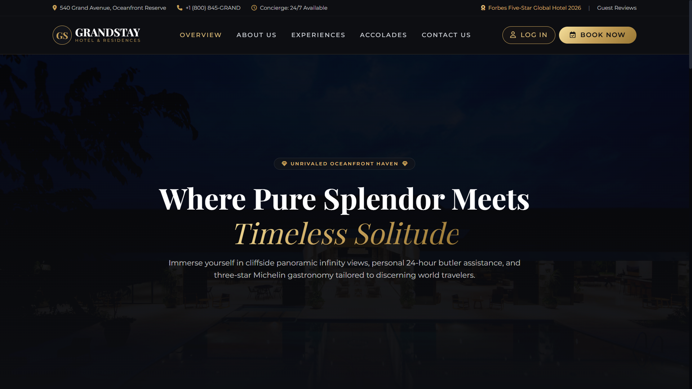
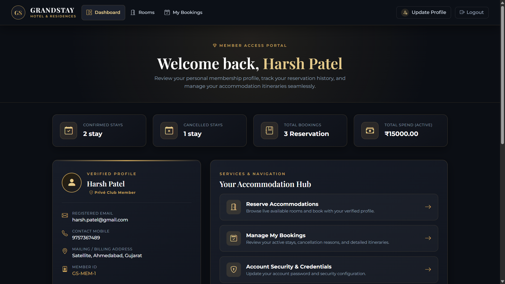
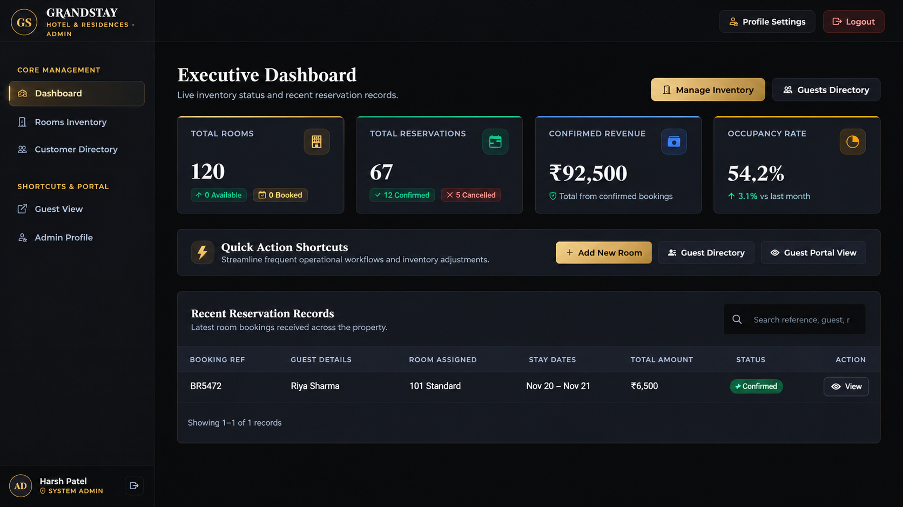

# GrandStay Hotel & Residences

  

  <strong>Luxury Hospitality & Suite Reservation Management Platform</strong>

---

## Overview

**GrandStay Hotel & Residences** is an enterprise-grade hospitality platform crafted to deliver a seamless experience for luxury travelers while providing hotel staff with powerful operational controls.

The platform is divided into two distinct portals:
1. **Guest Portal (Privé Society)** – A curated digital concierge for guests to explore suites, inspect amenities, book reservations, and manage their personal stay history.
2. **Administrative Console (Executive Suite)** – An operational command center for hotel management to oversee inventory, monitor live performance metrics, upload suite imagery, and moderate customer accounts.

---

## 1. Guest Experience (Privé Society)

  

The Guest Portal is designed with elegance and ease-of-use, guiding guests from initial suite exploration to check-out.

### Key Guest Capabilities:

- **Suite Discovery & Catalog Exploration**:
  - Browse luxury rooms and suites accompanied by high-resolution visual previews, room dimensions (sq. ft.), guest capacity, and bed arrangements.
  - Filter across room categories: *Presidential Suite*, *Deluxe Suite*, *Executive Room*, *Standard Suite*, and *Ocean View Penthouse*.
  - Refine searches based on night pricing, guest count, and bed type (King Bed, Queen Beds).

- **Curated Room Amenities**:
  - Detailed badges highlighting in-room comforts: High-Speed Wi-Fi, Climate Control, Smart TV, Mini Bar, Soaking Tub, Private Balcony, and Executive Work Desk.

- **Real-Time Reservation Engine**:
  - Interactive date selectors for arrival and departure dates.
  - Automatic validation preventing booking conflicts and invalid date sequences (`check_out > check_in`).
  - Instant pricing calculation dynamically totaling the cost based on nights stayed.
  - Unique booking confirmation reference generated for each reservation.

- **My Reservations (Stay Management)**:
  - Personal reservation dashboard displaying active, upcoming, and past stays.
  - Full booking breakdown: booking reference, dates of stay, guest count, total cost, and current status.
  - Self-service reservation cancellation option with status updates.

- **Guest Profile & Security**:
  - Self-registration with input validation for full name, email, contact number, and residence address.
  - Personal profile editor to keep contact information and billing addresses up to date.
  - Secure credential management allowing guests to update their password with existing password confirmation.

---

## 2. Administrator Operations (Executive Console)

  

The Administrative Console provides hotel executives and managers with full control over property inventory, reservations, customer accounts, and performance analytics.

### Key Administrator Capabilities:

- **Live Operational KPI Dashboard**:
  - Real-time metric cards reporting property health at a glance:
    - **Total Inventory**: Overall count of suites and rooms across the property.
    - **Room Availability**: Instant breakdown of *Available*, *Occupied*, and *Maintenance* rooms.
    - **Guest Directory Metrics**: Active guest profiles versus restricted/blocked accounts.
    - **Financial & Booking Performance**: Total confirmed reservations and cumulative confirmed revenue.

- **Suite & Room Inventory Management**:
  - Complete inventory lifecycle management: Add new rooms, update details, adjust nightly rates, or retire suites.
  - Configure room numbers, category associations, maximum guest capacity, floor area in square feet, and bed configurations.
  - Change room operational status: *Available*, *Booked*, or *Under Maintenance*.
  - **Multi-Photo Gallery Upload**: Upload high-resolution suite photos directly to the system gallery and toggle primary display images.

- **Amenity Configuration**:
  - Fine-grained control over room amenities, allowing managers to assign specific features and perks to each suite.

- **Guest Directory & Account Moderation**:
  - Centralized customer management directory listing all registered guests.
  - View guest contact details, total reservation counts, and lifetime revenue spent at the hotel.
  - One-click account status toggle: Switch accounts between **Active** and **Blocked**.
  - Administrative reason logging: Enter documented explanations when restricting a guest account.

- **Role-Based Access Protection**:
  - Strict security verification ensuring administrative dashboards and inventory controls remain accessible solely to authenticated hotel staff.

---

  GrandStay Hotel & Residences &copy; Luxury Hospitality Platform

